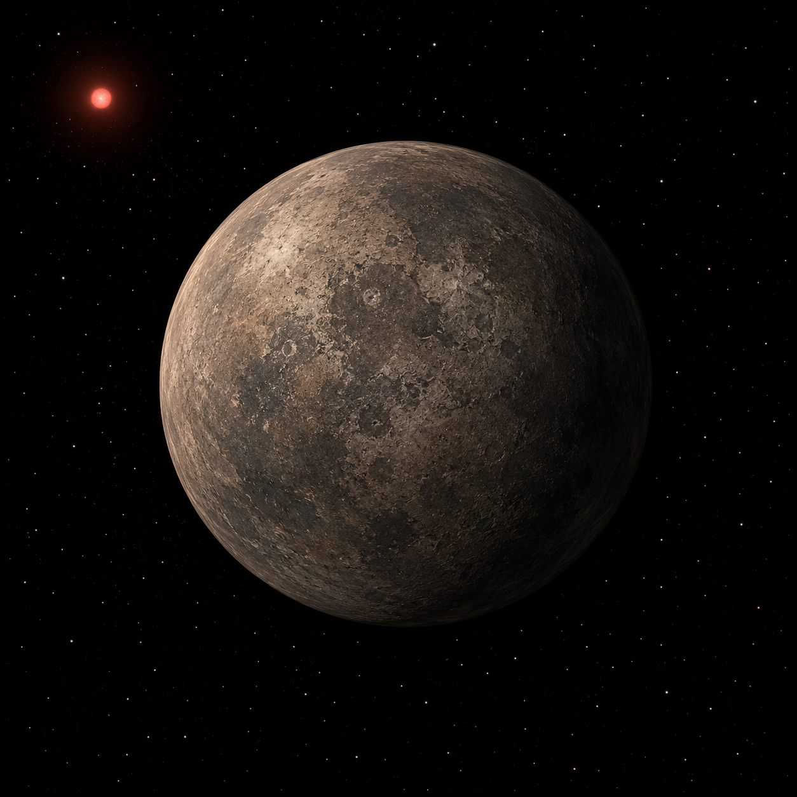

# TRAPPIST-1 e — Exoplanet Atmosphere Report
<!-- RESEARCH-IDENTITY-START -->
**Independent research report by [Biswajit Jana](https://biswajit1999.github.io/Biswajit_Jana.github.io/)** · [Live report](https://biswajit1999.github.io/trappist-1e-exoplanet-report/) · [ORCID](https://orcid.org/0009-0002-2411-1891) · [Complete research portfolio](https://biswajit1999.github.io/Biswajit_Jana.github.io/research/exoplanets/)
<!-- RESEARCH-IDENTITY-END -->


<p align="center">
  
</p>

<p align="center"><em>AI-generated artist's concept — not a real photograph. See the report for actual JWST NIRSpec/PRISM data.</em></p>

One of the most Earth-like planets known by size and insolation, and
one of JWST's highest-priority habitable-zone targets. This repo tests
its own decontaminated JWST NIRSpec/PRISM transmission spectrum for
flatness and reports the result next to the atmosphere constraints
Espinoza et al. (2025) actually publish.

**[Open the full report](https://biswajit1999.github.io/trappist-1e-exoplanet-report/)** — the live GitHub Pages version. You can also open `index.html` locally in a browser, or serve it with `python -m http.server` from this directory.

## Data sources

- **System parameters** — from the NASA Exoplanet Archive TAP
  service (`pscomppars`).
- **Transmission products** — the final GP-decontaminated combination and
  all 24 published pipeline/visit spectra from Espinoza et al. (2025),
  *JWST-TST DREAMS: NIRSpec/PRISM Transmission Spectroscopy of the Habitable
  Zone Planet TRAPPIST-1e*, ApJL 990, L52 (arXiv:2509.05414). Six pipelines
  reduce each of four visits, so these are four observations—not 24
  independent replicates. See [data/SOURCE.md](data/SOURCE.md) and
  [data/pipeline_visits/SOURCE.md](data/pipeline_visits/SOURCE.md).
- **Analysis** — `scripts/analyze_spectrum.py` fits descriptive constant-depth
  models, compares pipeline sensitivity by visit, and exports CSV/JSON results
  plus a three-panel scientific figure. Run it yourself:

  ```bash
  pip install -r requirements.txt
  python scripts/analyze_spectrum.py
  ```

## Repository structure

```text
index.html              the report webpage
data/                    final spectrum + 24 pipeline/visit products
scripts/analyze_spectrum.py   final-spectrum and reduction-sensitivity audit
figures/                 generated figure plus CSV and JSON results
tests/                   regression, grouping, output, and failure-mode tests
```

## Tests

`tests/test_analysis.py` checks the spectrum loader and the
chi-squared/p-value formula against a known analytic case, and reruns
the full pipeline on the real downloaded spectrum, verifying it still
reproduces the numbers this README documents. Runs automatically on
every push via GitHub Actions; run locally with:

```bash
pytest tests/ -v
```

## What the numbers show

A chi-squared of 42.85 over 66 degrees of freedom (reduced χ² = 0.649,
p = 0.988) does not reject a fitted constant under the deliberately simple
diagonal-error likelihood. The standardized-residual RMS is 0.800 and the
largest absolute standardized residual is 1.930. The unusually high p-value
is not positive evidence for a featureless planet; it can also reflect
conservative marginal uncertainties or covariance omitted from this test.

The 24 intermediate products add an important robustness diagnostic. Across
the six reductions, the median weighted mean depths of visits 001, 002, 003,
and 104 are 5089.6, 5075.4, 5014.9, and 4715.2 ppm. Visit 104 is 360.2 ppm
below the median of the earlier visit medians in every reduction, while the
between-pipeline range grows from roughly 90–96 ppm in visits 001–003 to
160.0 ppm in visit 104. This is a visit/reduction sensitivity result, not an
atmospheric signal. It helps motivate the published stellar-contamination and
Gaussian-process treatment rather than replacing it.

Flatness alone doesn't rule out an atmosphere—a high-altitude cloud deck or a
compact, high-mean-molecular-weight atmosphere can look flat too.
Espinoza et al. (2025) push further with their own retrieval framework
and report ruling out cloudy, primary hydrogen-dominated atmospheres (at
least 80% H2 by volume) at better than 3σ, while denser secondary
atmospheres remain possible — addressed further in the companion paper
by Glidden et al. (2025).

## Limitations

All constant fits in this repo treat each wavelength point's quoted error as
independent (a diagonal-covariance likelihood). The paper's stellar-
contamination correction was derived with a Gaussian-process
marginalization over correlated systematics, which a diagonal
chi-squared on the output spectrum doesn't reproduce. The six reductions per
visit also share the same photons and must not be treated as independent
evidence. This is a descriptive sensitivity audit, not the retrieval used to reach
its own quantitative atmosphere limits, and shouldn't be read as
reproducing that result. Separately: NIRSpec/PRISM's actual resolving
power is R~30-300 (wavelength-dependent, nominally R~100) — the
"R10000" appearing in the source data filename labels the pipeline's
internal wavelength resampling grid, not the spectrum's real spectral
resolution. An earlier version of this repository analyzed TRAPPIST-1b
instead of e, because no TRAPPIST-1e-specific spectrum had been
published when it was written; that's no longer the case, and this
version uses the planet's own data.

## References

1. Gillon, M. et al., 2017. Seven temperate terrestrial planets around
   the nearby ultracool dwarf star TRAPPIST-1. *Nature*, 542,
   pp.456-460.
2. Espinoza, N. et al., 2025. JWST-TST DREAMS: NIRSpec/PRISM
   Transmission Spectroscopy of the Habitable Zone Planet TRAPPIST-1 e.
   *The Astrophysical Journal Letters*, 990(2), L52 (arXiv:2509.05414).
3. Glidden, A. et al., 2025. JWST-TST DREAMS: Secondary Atmosphere
   Constraints for the Habitable Zone Planet TRAPPIST-1 e. *The
   Astrophysical Journal Letters*, 990(2), L53.
4. Agol, E. et al., 2021. Refining the Transit-timing and Photometric
   Analysis of TRAPPIST-1: Masses, Radii, Densities, Dynamics, and
   Ephemerides. *The Planetary Science Journal*, 2, 1.
5. NASA Exoplanet Archive, <https://exoplanetarchive.ipac.caltech.edu/>.

## Author

Biswajit Jana — [Portfolio](https://biswajit1999.github.io/Biswajit_Jana.github.io/) · [GitHub](https://github.com/Biswajit1999) · [LinkedIn](https://www.linkedin.com/in/biswajit-jana-27011a151/) · [ORCID](https://orcid.org/0009-0002-2411-1891)
